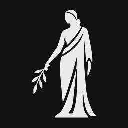

<h1 align="center">Dea Dardanica</h1>

A browser, a terminal and a local MCP server in one window. You browse and code; your coding agent drives the same browser beside you.

## Download

Get the latest version from **[Releases](https://github.com/neonn0d/dea-releases/releases/latest)**.

| Platform | File |
| --- | --- |
| Windows x64 | `Dea-<version>-windows-x64.exe` (installer) or `.zip` |
| macOS Apple Silicon | `Dea-<version>-arm64.dmg` or `.zip` |
| macOS Intel | `Dea-<version>-x64.dmg` or `.zip` |
| Linux x64 | `Dea-<version>-x86_64.AppImage` or `Dea-<version>-amd64.deb` |

The builds are not signed yet, so Windows and macOS show a security prompt the
first time you open Dea. On macOS, allow it in System Settings → Privacy &
Security.

## What it does

- **A real browser** on Chromium, with tabs, private tabs and split view, that looks like Chrome to the sites you visit.
- **A real terminal** beside the page, with as many tabs as you need.
- **An MCP server** on `127.0.0.1:7704`, so Claude Code, Codex, OpenCode, Antigravity or any MCP client can navigate, read, click and type in the same browser you are looking at.
- **Connect every agent** in one click from the Connection screen.
- **Projects** remember which agent last worked in each folder, and continue its session in one click.

Made in Dardania by [@neonn0d](https://x.com/neonn0d).
